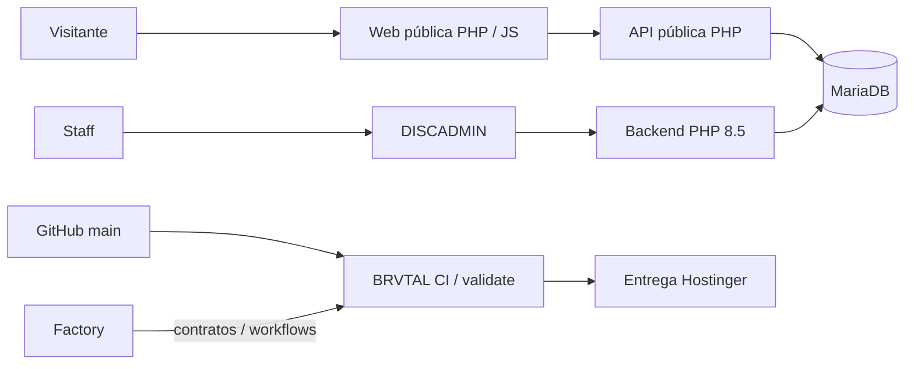

# BRVTAL

> Plataforma underground de música y archivo cultural con una experiencia pública editorial y un DISCADMIN unificado.

**Rol en la fábrica:** product · **Roadmap:** [Issue #533](https://github.com/pl0n3r/brvtal/issues/533) · **Fase:** [configuración](readme/project.json) y [tratamiento de datos](datos.yml) pendientes de conciliación en [#1009](https://github.com/pl0n3r/brvtal/issues/1009).

Esta portada sigue **README Contract v2**: descripción duradera y enlaces a señales vivas; no duplica estado, progreso ni decisiones de GitHub. La fuente ejecutable es [`main`](https://github.com/pl0n3r/brvtal/tree/main).

## Operational Cockpit

[](https://github.com/pl0n3r/brvtal/actions/workflows/update-release-metadata.yml)
[](https://github.com/pl0n3r/brvtal/releases)

[GitHub Actions](https://github.com/pl0n3r/brvtal/actions) · [GitHub Releases](https://github.com/pl0n3r/brvtal/releases) · [Orquestador de ControlBot](https://control.condorapp.com.co/)

Las insignias consultan fuentes externas al abrir la página; no requieren commits de actualización. Para salud, checks exact-SHA, despliegue y decisiones utiliza sus registros canónicos; el README no certifica producción.

## Work Queue

- **NOW:** [Issues críticos abiertos](https://github.com/pl0n3r/brvtal/issues?q=is%3Aissue%20is%3Aopen%20label%3A%22priority%3A%20critical%22) y [PRs abiertos](https://github.com/pl0n3r/brvtal/pulls?q=is%3Apr%20is%3Aopen). GitHub determina el estado actual.
- **NEXT:** [Issues disponibles](https://github.com/pl0n3r/brvtal/issues?q=is%3Aissue%20is%3Aopen%20label%3A%22status%3A%20available%22), sujetos a reservas y dependencias; no son autorización automática de despliegue.
- **LATER:** [Roadmap #533](https://github.com/pl0n3r/brvtal/issues/533) y [backlog abierto](https://github.com/pl0n3r/brvtal/issues?q=is%3Aissue%20is%3Aopen), sin duplicar un listado que caduca con cada merge.
- **BLOCKED:** [Issues bloqueados](https://github.com/pl0n3r/brvtal/issues?q=is%3Aissue%20is%3Aopen%20label%3A%22status%3A%20blocked%22). Cada Issue conserva la causa y la condición de desbloqueo.

Esta selección es navegación editorial, no un segundo planificador. Consulta los [Issues abiertos](https://github.com/pl0n3r/brvtal/issues?q=is%3Aissue+is%3Aopen) para obtener el estado actualizado.

## Qué hace el producto

- **Archivo público:** artistas, eventos, sets, contenido editorial, conexiones y SEO servidos por [`index.php`](https://github.com/pl0n3r/brvtal/blob/main/index.php) y [`api/public.php`](https://github.com/pl0n3r/brvtal/blob/main/api/public.php).
- **DISCADMIN:** administración editorial y de Media, publicación, configuración y panel operativo; entrada en [`discadmin/index-core.php`](https://github.com/pl0n3r/brvtal/blob/main/discadmin/index-core.php).
- **Contenido en español canónico y navegación ES/EN:** contrato documentado en [#212](https://github.com/pl0n3r/brvtal/issues/212); el [adaptador DeepL de prueba](https://github.com/pl0n3r/brvtal/blob/main/config/public_translation_deepl.php) **no implica activación ni compra del proveedor** ([#920](https://github.com/pl0n3r/brvtal/issues/920)).
- **Concept 05, Journal y Connected:** [#973 / PR #1012](https://github.com/pl0n3r/brvtal/pull/1012). **Duración de sets:** [#987 / PR #1008](https://github.com/pl0n3r/brvtal/pull/1008). Consulta el estado vigente de cada trabajo en GitHub; su integración no certifica despliegue.

Las funcionalidades y decisiones permanentes se describen en [`docs/BRVTAL-SPEC.md`](https://github.com/pl0n3r/brvtal/blob/main/docs/BRVTAL-SPEC.md); los cambios concretos viven en PRs y Releases.

## Arquitectura en 60 segundos



El render público se compone desde [`index.php`](https://github.com/pl0n3r/brvtal/blob/main/index.php) y sus [parciales](https://github.com/pl0n3r/brvtal/tree/main/partials/home). La API y DISCADMIN comparten persistencia pero no la frontera de autorización; el admin opera con sesión y controles propios (véase [especificación](https://github.com/pl0n3r/brvtal/blob/main/docs/BRVTAL-SPEC.md)).

## Stack e infraestructura

- **Runtime:** PHP 8.5, HTML/CSS/JavaScript y MariaDB; configuración y dependencias en [`composer.json`](https://github.com/pl0n3r/brvtal/blob/main/composer.json) y [`package.json`](https://github.com/pl0n3r/brvtal/blob/main/package.json).
- **Hosting y entrega:** Hostinger, supervisión de release y observación productiva documentadas en el [roadmap #533](https://github.com/pl0n3r/brvtal/issues/533); deploy no equivale a validación productiva.
- **Pruebas:** contratos PHP/Python, integración y Playwright Chromium/WebKit, según [estrategia de pruebas](https://github.com/pl0n3r/brvtal/blob/main/docs/TESTING.md).
- **Automatización:** [BRVTAL CI](https://github.com/pl0n3r/brvtal/actions/workflows/update-release-metadata.yml) y [workflows de Factory](https://github.com/pl0n3r/factory/tree/main/.github/workflows).

## Ciclo de entrega

[Issue](https://github.com/pl0n3r/brvtal/issues) → `/take` y reserva V3 → `work/issue-N` → [PR](https://github.com/pl0n3r/brvtal/pulls) → [BRVTAL CI / validate](https://github.com/pl0n3r/brvtal/actions/workflows/update-release-metadata.yml) y revisiones → squash con puertas vigentes → validación exacta de `main` → observador y smoke de producción cuando corresponda.

La protección y los checks requeridos de `main` tienen [seguimiento operativo #1009](https://github.com/pl0n3r/brvtal/issues/1009); no se supone autorización de fusión por el simple color verde de un workflow.

## Calidad y seguridad

- `validate` (BRVTAL CI) verifica el código; [SonarCloud, CodeQL y CodeRabbit](https://github.com/pl0n3r/brvtal/pulls) complementan la revisión, sin reemplazar controles de seguridad.
- DISCADMIN y API mantienen las fronteras de autenticación y CSRF definidas en [especificación](https://github.com/pl0n3r/brvtal/blob/main/docs/BRVTAL-SPEC.md).
- Cambios en persistencia requieren migraciones compatibles, backup previo cuando corresponda y regresiones reproducibles ([pruebas](https://github.com/pl0n3r/brvtal/blob/main/docs/TESTING.md)).
- Sin secretos, tokens, contraseñas ni datos personales en Git. La fase de `datos.yml` y la de `readme/project.json` aún difieren: [#1009](https://github.com/pl0n3r/brvtal/issues/1009) documenta el veto a inferir go-live o merge autónomo.

## Roadmap y fuentes de verdad

- [Roadmap y orden de ejecución — #533](https://github.com/pl0n3r/brvtal/issues/533); [Issues](https://github.com/pl0n3r/brvtal/issues) y [PRs](https://github.com/pl0n3r/brvtal/pulls) reflejan estados actuales.
- [`AGENTS.md`](https://github.com/pl0n3r/brvtal/blob/main/AGENTS.md): ejecución del agente; [`docs/BRVTAL-SPEC.md`](https://github.com/pl0n3r/brvtal/blob/main/docs/BRVTAL-SPEC.md): producto y arquitectura.
- [`docs/TESTING.md`](https://github.com/pl0n3r/brvtal/blob/main/docs/TESTING.md): pruebas; [`decisiones.yml`](https://github.com/pl0n3r/brvtal/blob/main/decisiones.yml): decisiones; [`datos.yml`](https://github.com/pl0n3r/brvtal/blob/main/datos.yml): privacidad.
- [Releases](https://github.com/pl0n3r/brvtal/releases): entregas; [Factory PLAN-AGENTES.md](https://github.com/pl0n3r/factory/blob/main/PLAN-AGENTES.md): gobernanza.

El README solo enlaza las fuentes, sin duplicar un changelog ni generar métricas estáticas.

## Desarrollo local

Comandos reproducibles principales:

```bash
composer install
npm ci
npm run test:contracts
npm run test:coordination
```

Para cobertura completa usa los comandos documentados en `docs/TESTING.md` y los workflows de CI. Los E2E no usan credenciales ni datos productivos.

## Mapa de la fábrica

- **Factory:** governance/kit y workflows comunes.
- **ControlBot:** control plane; repositorio público, panel de acceso restringido.
- **FactoryRunner:** execution plane autónomo.
- **Condor / GrindFlow / BRVTAL:** productos.
- **AutoFactory:** herramienta local/manual del dueño.

**BRVTAL** es el producto actual de este repositorio; su operación no transfiere responsabilidades de control plane ni execution plane a otros componentes.
